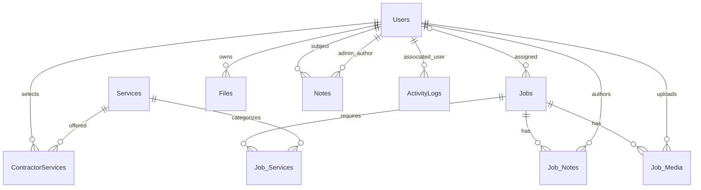

# SQL schema and relationship audit

Audited: 2026-10-01 (Asia/Shanghai). Source: `nestcrafters_database.sql`, 3,077,625 bytes; SHA-256 `3ebef325d80b514f900f462673ba40398365fbbcdb4162c20b00771469495fc5`.

## Subsequent M2 verification

The user later authorized M2. The supplied export is now natively restored in isolated nestcrafters_m2_legacy and populated in nestcrafters_local, with all 412 rows and 77 original column definitions verified. Target tables use InnoDB/utf8mb4, explicit model/key mappings and 12 restrictive domain FKs; the 15 orphan logs remain without a FK. Four private copies totaling 2,899,381 bytes match the source BLOBs, which are retained. All original hashes/IDs/statuses/nulls/decimal/date strings and UTF-8 literal bytes reconcile. The completed staging account is SELECT-only. See [M2 report](m2-data-migration.md) for actual evidence, constraints and operational limits; the original source DDL and audit below remain unchanged reference evidence. Snapshot consistency and production completeness are still unknown.

## Subsequent M3 identity tables

Subsequent M3 adds four separate app_ identity/token/event/delivery tables, for 19 target tables in total. Existing legacy columns/relationships and source rows remain unchanged. See [M3 relationship extensions](m3-identity-permissions.md#database-additions-and-preservation) for one-to-one User state and notification FKs. All 33 imported accounts remain unverified; no proof or workflow events were inferred from the export.

## Export evidence

The export has 11 CREATE TABLE definitions, DROP TABLE statements, 412 single-row INSERT statements and foreign-key-check toggles. It begins with `SET FOREIGN_KEY_CHECKS=0` and ends with `SET FOREIGN_KEY_CHECKS=1`. There is no declared export charset/SQL mode/timezone or transaction/snapshot metadata. There are no foreign-key constraints in the supplied definitions. Table indexes are not foreign keys. Prior handoff says a custom PHP exporter generated it; triggers/views/routines/events and snapshot consistency were not verified.

All tables are `ENGINE=MyISAM DEFAULT CHARSET=latin1`. MyISAM does not support transactions or foreign keys; legacy begin/commit/rollback calls do not make these workflows atomic. [MySQL storage engine documentation](https://dev.mysql.com/doc/refman/8.0/en/myisam-storage-engine.html).

Static byte parsing recognized quoted SQL escapes, kept NULL separate from empty strings, and checked every INSERT against exact column order. At the documentation-only audit, counts below were export-row counts and no restore had run. M2 subsequently restored and reconciled these exact counts; they remain distinct from AUTO_INCREMENT values and current production counts.

| Table | Export rows | Key / next AUTO_INCREMENT | Suggested Laravel model |
| --- | ---: | --- | --- |
| ActivityLogs | 215 | log_id / 216 | ActivityLog |
| ContractorServices | 117 | composite user_id, service_id; no auto ID | ContractorService pivot |
| Files | 2 | file_id / 5 | ContractorDocument (explicit Files table) |
| Job_Media | 0 | media_id / 11 | JobMedia |
| Job_Notes | 0 | note_id / 4 | JobNote |
| Job_Services | 5 | job_service_id / 74 | JobService pivot/model |
| Jobs | 1 | job_id / 8 | Job |
| Notes | 0 | note_id / 3 | ContractorNote |
| Services | 36 | service_id / 44 | Service |
| Templates | 3 | template_id / 5 | Template |
| Users | 33 | user_id / 62 | User (Authenticatable) |

Gaps in IDs and empty tables are not proof of a failed export: deletions can explain them. Empty notes/media tables mean there are no imported examples to test those behaviors; create sanitized fixtures later.

## Logical relationship map

These are inferred from columns and source joins, not enforced SQL foreign keys. Parent deletion behavior must be decided explicitly before target constraints are added.



Templates is standalone: Jobs copy HTML from a selected template; there is no template_id relation. Email/Contractor template types exist but no recovered consumer is implemented. Historical orphan log users are an exception to the intended ActivityLogs relationship.

| Child reference | Parent | Target relationship / semantics |
| --- | --- | --- |
| ContractorServices.user_id | Users.user_id | User belongsToMany Service using explicit pivot/table/keys; intended contractor-only, DB does not enforce role |
| ContractorServices.service_id | Services.service_id | Service belongsToMany User |
| Jobs.contractor_id (nullable) | Users.user_id | Job belongsTo contractor; User hasMany assigned Jobs; DB does not enforce contractor role/approval |
| Job_Services.job_id, service_id | Jobs.job_id, Services.service_id | Job belongsToMany Service; unique pair and retained job_service_id |
| Files.user_id | Users.user_id | User hasMany ContractorDocument |
| Job_Media.job_id, uploaded_by | Jobs.job_id, Users.user_id | Job hasMany JobMedia; media belongsTo uploader, which is independent of current assignee |
| Job_Notes.job_id, created_by | Jobs.job_id, Users.user_id | Job hasMany JobNote; note belongsTo author, independent of assignee |
| Notes.user_id, admin_id | Users.user_id twice | ContractorNote belongsTo subject and admin author; separate aliases |
| ActivityLogs.user_id | Users.user_id | Associated user is sometimes actor, sometimes target/recipient; preserve original interpretation, do not invent actor metadata from prose |

Static reference checks found no missing targets in the non-log references, including the one job assignment and both documents. **15 ActivityLogs rows reference absent users:** target user IDs 11 (5 rows), 12 (8), 14 (2). Preserve the raw legacy user_id and log contents; use a nullable new actor relation or a separate legacy-reference field instead of inventing user records or deleting logs. Actor-role intent for Notes.admin_id cannot be proven from an empty Notes table.

## Data/state observations

- Users: 2 admins, 31 contractors. Contractor approvals: 28 state 0, 2 state 1, 1 state 2. These match 29 pending/review and 31 missing-W9 dashboard counts in the snapshot; there are no W9 rows.
- All 33 password hashes have bcrypt `$2y$10$` prefix. Preserve each hash verbatim; custom user_id/password_hash authentication mapping and controlled compatibility tests are required. A prefix check is not proof that every stored hash is valid or that known credentials authenticate. Laravel supports bcrypt; select a compatible driver and verify before considering any fallback. [Laravel hashing](https://laravel.com/framework/docs/hashing).
- One User email is NULL; unique email indexes allow NULL contacts. Two redundant unique indexes (`email`, `email_2`) have identical columns. Preserve semantics initially, document removal of the redundant index separately.
- Approval 0 is used for new/unapproved users, 1 approved, 2 pending admin review. SQL allows NULL for role/status despite UI treating them as booleans/state; preserve and report out-of-range/NULL values during import rather than defaulting silently. Profile/service edits reset status without consistently changing approved_date.
- The single job is assigned, accepted, not completed; its acceptance timestamp is present. No flag/timestamp inconsistency was observed in that row or approval dates of contractor rows. Source handlers can still produce inconsistencies in later records.
- Two Files rows: one archived Other document and one active Insurance document. Static SQL-unescaped payloads total 2,800,196 bytes (JPEG and PDF signatures). Two non-NULL profile_photo payloads total 99,185 bytes (JPEG signatures). No Job_Media BLOBs exist in the export. Signatures/lengths are provisional; decoding/full integrity and restored byte equality remain unverified.
- SQL DECIMAL(10,2) preserves cents; source PHP float/integer bindings do not always do so. Preserve amounts as decimal strings or integer minor units in application logic; distinguish 0.00 from NULL.
- Text includes rich HTML and may include already-escaped profile strings. Do not globally decode HTML entities or blindly convert text from latin1: the exporter connection charset is absent. Verify non-ASCII values and original byte sequences in staging, then convert to utf8mb4 with an explicit per-column plan. BLOBs must never pass through text conversion.
- DATETIME fields have no timezone information. Templates use TIMESTAMP; preserve timezone behavior during restore/export. The user's Asia/Shanghai audit date is not evidence of the business timezone.

## Initial Laravel schema mapping

Keep all 11 legacy table names and primary keys. Explicitly set `$table`, `$primaryKey`, relationships and legacy datetime casts; do not assume `id`, plural snake-case names, or universal created_at/updated_at. Most models should disable automatic timestamps and actions should set the existing named dates. Users has created_at but no updated_at; Templates has both. ContractorServices is a composite pivot managed through belongsToMany/sync rather than default Eloquent single-ID saves. Job_Services retains its surrogate key and unique pair.

Map authentication to password_hash without exposing it through serialization. Cast boolean flags separately from the three-value approval enum; approval is not boolean. File unique_file_id is alphanumeric but has **no index/unique constraint**, despite its name; check duplicates before adding one. File archived is NOT NULL with **no default**; inserts must explicitly use 0. MIME/type/display filename validation is application-level; file_type is free text, tag alone is ENUM. Neither note table has a visibility/archive flag. Jobs has no acceptance actor, terms version, assignment history, created_by or updated_at.

Preserve immutable imported rows in staging. For the target, document explicit migrations to InnoDB and utf8mb4, integrity fixes, nullable historical actor handling and constraints. Add ancillary Laravel tables/columns only deliberately: email verification and account lifecycle, session/reset support, in-app notifications/preferences/delivery/outbox, registration-review metadata, private storage metadata (disk/key, MIME, size, SHA-256), typed actor/subject logs, and job transition history. Avoid collapsing rejected/archived/blocked into approval=0; those are new lifecycle concepts.

Potential target constraints after reconciliation: owner/author/job/service references, unique document public IDs, status/flag ranges, nonnegative prices/deposit rules, valid state/timestamp combinations. Prefer restricted/archived account/service deletion; job-child purge and any actor anonymization require D6. Add query indexes for approval/role/priority, job assignment/status/due dates, file type/archive/expiry, job note/media pagination, and log filters based on actual query plans.

### Scaffold and identifier review

Reserve legacy table names case-insensitively before any generated migrations run. A default database queue table `jobs` can collide with domain `Jobs` on case-insensitive MySQL; the default `users` scaffold can also conflict with `Users`. Adapt auth migrations to the actual Users table instead of creating a second account table, and configure queue storage separately (recommended `app_queue_jobs`). Name other ancillary tables explicitly and inspect selected framework migrations first. Check lower_case_table_names on local/test/hosting databases; Windows success does not prove Linux name handling or the reverse. This is a prospective compatibility risk, not an observed restore failure. [MySQL identifier rules](https://dev.mysql.com/doc/refman/8.0/en/identifier-case-sensitivity.html), [Laravel database queues](https://laravel.com/framework/docs/queues#database).

Legacy primary/reference IDs are signed INT. Any new actual FK to Users.user_id, Jobs.job_id or another legacy key must explicitly match its type and column name; do not blindly scaffold unsigned BIGINT foreignId references to users.id. Polymorphic notification keys and session associations need explicit mapping to the authenticatable User key too. Dedicated import actions must preserve historical records without running new registration FormRequests, synthesizing verification dates or firing notification hooks. See [review.md](review.md) for technical-review findings and proposed workflow defaults.

## Exact source definitions

The definitions below are copied from the local export. They contain schema only; no credential hashes, contacts or document contents. Their AUTO_INCREMENT values indicate historical next IDs, not current row counts.

### ActivityLogs

Source SQL line 4.

```sql
CREATE TABLE `ActivityLogs` (
  `log_id` int NOT NULL AUTO_INCREMENT,
  `user_id` int NOT NULL,
  `action` text NOT NULL,
  `timestamp` datetime NOT NULL,
  PRIMARY KEY (`log_id`),
  KEY `user_id` (`user_id`)
) ENGINE=MyISAM AUTO_INCREMENT=216 DEFAULT CHARSET=latin1;
```

### ContractorServices

Source SQL line 230.

```sql
CREATE TABLE `ContractorServices` (
  `user_id` int NOT NULL,
  `service_id` int NOT NULL,
  PRIMARY KEY (`user_id`,`service_id`),
  KEY `service_id` (`service_id`)
) ENGINE=MyISAM DEFAULT CHARSET=latin1;
```

### Files

Source SQL line 356.

```sql
CREATE TABLE `Files` (
  `file_id` int NOT NULL AUTO_INCREMENT,
  `user_id` int NOT NULL,
  `unique_file_id` varchar(32) NOT NULL,
  `file_type` varchar(50) NOT NULL,
  `file_name` varchar(255) DEFAULT NULL,
  `file_data` longblob NOT NULL,
  `mime_type` varchar(50) NOT NULL,
  `upload_date` datetime NOT NULL,
  `expiry_date` date DEFAULT NULL,
  `archived` tinyint(1) NOT NULL,
  PRIMARY KEY (`file_id`),
  KEY `user_id` (`user_id`)
) ENGINE=MyISAM AUTO_INCREMENT=5 DEFAULT CHARSET=latin1;
```

### Job_Media

Source SQL line 375.

```sql
CREATE TABLE `Job_Media` (
  `media_id` int NOT NULL AUTO_INCREMENT,
  `job_id` int NOT NULL,
  `file_name` varchar(255) NOT NULL,
  `file_data` mediumblob NOT NULL,
  `mime_type` varchar(100) NOT NULL,
  `tag` enum('Before','During','After','Other') NOT NULL DEFAULT 'Other',
  `upload_datetime` datetime NOT NULL DEFAULT CURRENT_TIMESTAMP,
  `uploaded_by` int NOT NULL,
  PRIMARY KEY (`media_id`),
  KEY `job_id` (`job_id`),
  KEY `uploaded_by` (`uploaded_by`)
) ENGINE=MyISAM AUTO_INCREMENT=11 DEFAULT CHARSET=latin1;
```

### Job_Notes

Source SQL line 391.

```sql
CREATE TABLE `Job_Notes` (
  `note_id` int NOT NULL AUTO_INCREMENT,
  `job_id` int NOT NULL,
  `note_text` text NOT NULL,
  `created_datetime` datetime NOT NULL DEFAULT CURRENT_TIMESTAMP,
  `created_by` int NOT NULL,
  PRIMARY KEY (`note_id`),
  KEY `job_id` (`job_id`),
  KEY `created_by` (`created_by`)
) ENGINE=MyISAM AUTO_INCREMENT=4 DEFAULT CHARSET=latin1;
```

### Job_Services

Source SQL line 404.

```sql
CREATE TABLE `Job_Services` (
  `job_service_id` int NOT NULL AUTO_INCREMENT,
  `job_id` int NOT NULL,
  `service_id` int NOT NULL,
  PRIMARY KEY (`job_service_id`),
  UNIQUE KEY `unique_job_service` (`job_id`,`service_id`)
) ENGINE=MyISAM AUTO_INCREMENT=74 DEFAULT CHARSET=latin1;
```

### Jobs

Source SQL line 419.

```sql
CREATE TABLE `Jobs` (
  `job_id` int NOT NULL AUTO_INCREMENT,
  `entered_datetime` datetime NOT NULL DEFAULT CURRENT_TIMESTAMP,
  `due_date` date DEFAULT NULL,
  `job_name` varchar(255) NOT NULL,
  `job_description` text,
  `is_accepted` tinyint NOT NULL DEFAULT '0',
  `accepted_datetime` datetime DEFAULT NULL,
  `terms` text,
  `contractor_id` int DEFAULT NULL,
  `is_completed` tinyint(1) NOT NULL DEFAULT '0',
  `completed_datetime` datetime DEFAULT NULL,
  `approved_price` decimal(10,2) DEFAULT NULL,
  `deposit_amount` decimal(10,2) DEFAULT NULL,
  `who_supplies_materials` varchar(100) DEFAULT NULL,
  PRIMARY KEY (`job_id`),
  KEY `contractor_id` (`contractor_id`)
) ENGINE=MyISAM AUTO_INCREMENT=8 DEFAULT CHARSET=latin1;
```

### Notes

Source SQL line 441.

```sql
CREATE TABLE `Notes` (
  `note_id` int NOT NULL AUTO_INCREMENT,
  `user_id` int NOT NULL,
  `admin_id` int NOT NULL,
  `note_text` text NOT NULL,
  `created_at` datetime NOT NULL,
  PRIMARY KEY (`note_id`),
  KEY `user_id` (`user_id`),
  KEY `admin_id` (`admin_id`)
) ENGINE=MyISAM AUTO_INCREMENT=3 DEFAULT CHARSET=latin1;
```

### Services

Source SQL line 454.

```sql
CREATE TABLE `Services` (
  `service_id` int NOT NULL AUTO_INCREMENT,
  `service_name` varchar(100) NOT NULL,
  PRIMARY KEY (`service_id`),
  UNIQUE KEY `service_name` (`service_name`)
) ENGINE=MyISAM AUTO_INCREMENT=44 DEFAULT CHARSET=latin1;
```

### Templates

Source SQL line 499.

```sql
CREATE TABLE `Templates` (
  `template_id` int NOT NULL AUTO_INCREMENT,
  `name` varchar(100) NOT NULL,
  `type` varchar(255) DEFAULT NULL,
  `html_content` text NOT NULL,
  `created_at` timestamp NOT NULL DEFAULT CURRENT_TIMESTAMP,
  `updated_at` timestamp NOT NULL DEFAULT CURRENT_TIMESTAMP ON UPDATE CURRENT_TIMESTAMP,
  PRIMARY KEY (`template_id`),
  UNIQUE KEY `name` (`name`)
) ENGINE=MyISAM AUTO_INCREMENT=5 DEFAULT CHARSET=latin1;
```

### Users

Source SQL line 515.

```sql
CREATE TABLE `Users` (
  `user_id` int NOT NULL AUTO_INCREMENT,
  `company_name` varchar(255) NOT NULL,
  `company_address` varchar(255) NOT NULL,
  `company_phone` varchar(50) DEFAULT NULL,
  `first_name` varchar(100) NOT NULL,
  `last_name` varchar(100) NOT NULL,
  `phone1` varchar(50) DEFAULT NULL,
  `phone1_type` varchar(75) NOT NULL,
  `phone2` varchar(50) NOT NULL,
  `phone2_type` varchar(75) NOT NULL,
  `email` varchar(255) DEFAULT NULL,
  `password_hash` varchar(255) NOT NULL,
  `profile_photo` longblob,
  `is_admin` tinyint(1) DEFAULT '0',
  `is_approved` tinyint(1) DEFAULT '0',
  `approved_date` datetime DEFAULT NULL,
  `created_at` datetime DEFAULT CURRENT_TIMESTAMP,
  `priority` int NOT NULL,
  PRIMARY KEY (`user_id`),
  UNIQUE KEY `email` (`email`),
  UNIQUE KEY `email_2` (`email`)
) ENGINE=MyISAM AUTO_INCREMENT=62 DEFAULT CHARSET=latin1;
```
